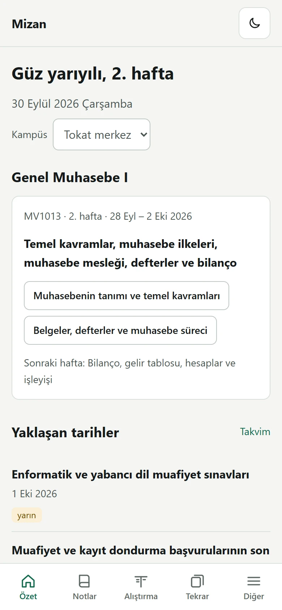
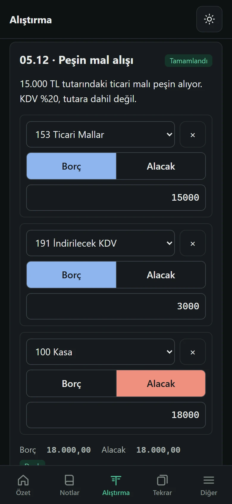
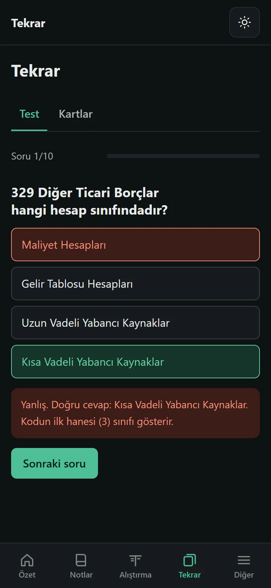
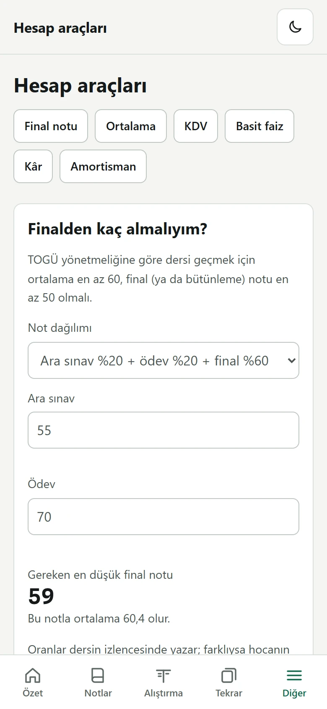
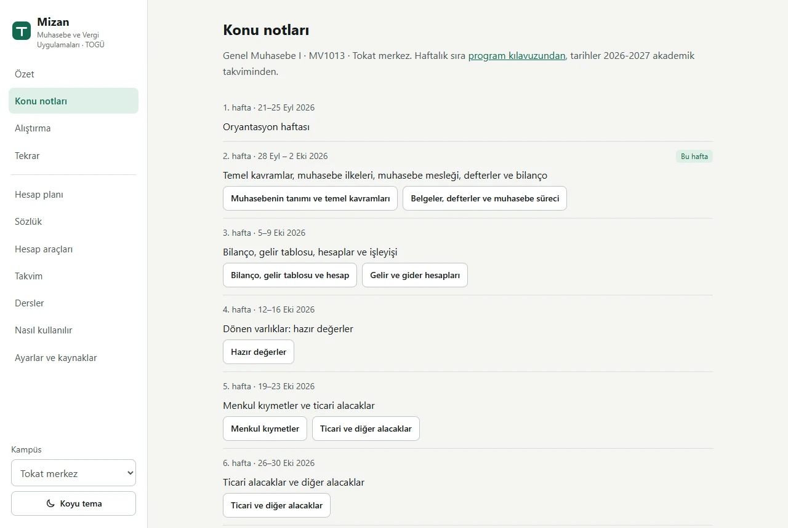
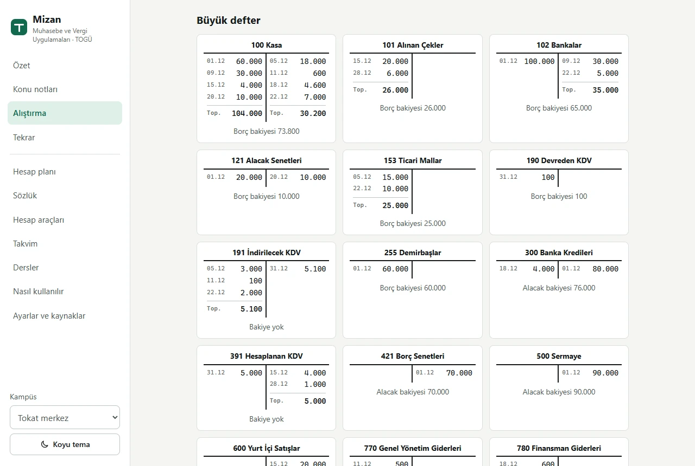

# Mizan

TOGÜ **Muhasebe ve Vergi Uygulamaları** (ön lisans) programına yeni başlayan öğrenci için ilk dönem çalışma uygulaması: konu notları, yevmiye alıştırmaları, tekrar testleri, hesap planı, sözlük, not ve KDV hesaplayıcıları, akademik takvim.

Ad, muhasebedeki borç = alacak kontrol tablosundan (mizan) geliyor.

- Hesap açmak gerekmez; bütün çalışma verileri telefonda ya da bilgisayarda, tarayıcının içinde kalır.
- Telefona uygulama olarak kurulur ve internet olmadan çalışır.
- Açık ve koyu tema; telefon, tablet ve bilgisayar ekranına göre düzenlenir.
- `index.html` tek başına bütün uygulamadır: bağımlılık yok, derleme yok. Dosyaya çift tıklayınca da açılır.

<table>
<tr>
<td width="25%"></td>
<td width="25%"></td>
<td width="25%"></td>
<td width="25%"></td>
</tr>
<tr>
<td>Özet</td><td>Yevmiye kaydı (koyu tema)</td><td>Test</td><td>Hesap araçları</td>
</tr>
</table>

<table>
<tr>
<td width="50%"></td>
<td width="50%"></td>
</tr>
<tr>
<td>Konu notları, haftalık plan</td><td>ABC Ticaret: büyük defter</td>
</tr>
</table>

## İçindekiler

| Bölüm | İçerik |
|---|---|
| Özet | Bugünün tarihine göre dönem ve hafta, Genel Muhasebe I'in o haftaki konusu, yaklaşan kayıt ve sınav tarihleri, çalışma durumu |
| Konu notları | Genel Muhasebe I'in 15 konusu: açıklamalar, tablolar, formüller, 45 örnek yevmiye kaydı; kampüse göre haftalık plan |
| Alıştırma | ABC Ticaret (10 kayıt, büyük defter ve mizan) ve 36 işlem türünden rastgele serbest alıştırma |
| Tekrar | 10 soruluk testler (45 soruluk banka ve her seferinde yeniden üretilen hesap soruları) ve 164 kart (hesap kodları, 12 temel kavram, sözlük) |
| Hesap planı | İlk yıl derslerinde geçen 89 hesap: kod, grup, borçta mı alacakta mı arttığı, ilgili konu |
| Sözlük | 63 terim |
| Hesap araçları | Finalden kaç almalıyım, dönem ortalaması, KDV, basit faiz, maliyet ve kâr, amortisman tablosu |
| Takvim | Güz, bahar ve yaz okulu tarihleri; işaretlenebilir kontrol listesi |
| Dersler | Birinci yarıyıl dersleri, geçme ve devam koşulları |
| Nasıl kullanılır | Uygulamanın tanıtımı |
| Ayarlar ve kaynaklar | Kampüs, tema, yedek alma ve geri yükleme, sıfırlama, kaynaklar, veri denetimi |

## Nasıl kullanılır

Aynı anlatım uygulamanın içinde **Diğer → Nasıl kullanılır** sayfasında da var. İlk açılışta Özet sayfasında bu sayfaya giden bir kutu görünür.

### İlk açılış

Özet sayfasından kampüs seçilir: Tokat merkez ya da Niksar. Genel Muhasebe I'in haftalık sırası, ders kodları ve not oranları kampüse göre değişir. Seçim daha sonra Ayarlar ve kaynaklar sayfasından da değiştirilebilir.

### Konu notları

Konular haftalık plana göre sıralanır; içinde bulunulan hafta işaretlidir. Her konuda kısa açıklamalar, tablolar, örnek yevmiye kayıtları ve o konunun hesapları vardır. Bir hesap koduna dokununca hesap planında o hesap açılır. Konu sayfasının sonundaki düğme aynı konudan alıştırma getirir.

### Yevmiye kaydı girmek

1. Her satırda hesabı seç.
2. Borç ya da Alacak tarafını seç.
3. Tutarı yaz: `15000` ya da `15.000`; kuruş için `15.000,50`.
4. Gerekirse **Satır ekle** ile satır ekle, **×** ile sil.
5. **Kontrol et** düğmesine bas ya da tutar kutusunda Enter'a bas.

| Mesaj | Anlamı |
|---|---|
| Kayıt denk değil | Borç ve alacak toplamları farklı. |
| Kayıt denk ama doğru değil | Toplamlar eşit ama bir hesap, taraf ya da tutar yanlış; hangisi olduğu yazılır. |
| Eski KDV oranı | KDV %18 ya da %8 ile hesaplanmış; genel oran %20. |
| Doğru | Kayıt kabul edildi; doğru kayıt tablo olarak gösterilir. |

**Çözüm** düğmesi doğru kaydı gösterir. Serbest alıştırmada çözüm açıldıktan sonra girilen kayıt doğru sayılmaz.

### ABC Ticaret

Aralık ayında kurulan bir işletmenin on işlemi. Tamamlanan her kayıt büyük defterdeki T hesaplara ve mizana aktarılır; on kayıt bitince mizanda borç ve alacak toplamları eşit çıkar. Son kayıt KDV mahsubudur ve önceki kayıtlardaki KDV tutarlarından hesaplanır.

### Serbest alıştırma

36 işlem türünden rastgele sorular; tutarlar her seferinde değişir. Konu seçilirse yalnızca o konudan soru gelir. Her sorunun ilk geçerli denemesi puana sayılır.

### Tekrar

- **Test:** 10 soru. Her cevaptan sonra açıklama gelir; sonunda yanlış cevaplar doğrularıyla listelenir. Son testlerin sonuçları saklanır.
- **Kartlar:** Karta dokununca cevap görünür; "Biliyordum" ya da "Bilmiyordum" seçilir. Bilinen kartlar daha seyrek gelir; üst üste dört kez bilinen kart öğrenilmiş sayılır.

### Hesap araçları

- **Finalden kaç almalıyım:** ara sınav ve ödev notuna göre dersi geçmek için gereken en düşük final notu (TOGÜ yönetmeliği: ortalama en az 60, final ya da bütünleme en az 50).
- **Ortalama:** harf notu ve krediye göre dönem ortalaması.
- **KDV:** dahil tutardan matrah, hariç tutardan KDV.
- **Basit faiz**, **maliyet ve kâr**, **amortisman tablosu** (normal ve azalan bakiyeler).

### Takvim

TOGÜ akademik takvimindeki kayıt, muafiyet, sınav, bayram ve telafi tarihleri. Kutular yalnızca o cihazda işaretlenir. Takvimin süresi dolduğunda Mizan bunu belirtir; yeni takvim eklenene kadar TOGÜ'nün sayfasına bakılmalıdır.

## Telefona kurmak

Site yayımlandıktan sonra adresi telefonda aç:

- **Android (Chrome):** menü → **Uygulamayı yükle** ya da **Ana ekrana ekle**.
- **iPhone (Safari):** Paylaş → **Ana Ekrana Ekle**.

Kurulduktan sonra ana ekrandaki simgeden açılır ve internet olmadan çalışır. Site güncellenince, internet varken ilk açılışta yeni sürüm alınır.

## Veriler

Kayıtlar, test sonuçları, kartlar ve takvim işaretleri yalnızca o tarayıcıda (`localStorage`) saklanır; hiçbir sunucuya gönderilmez. Uygulamada çerez, analiz ya da reklam kodu yok.

Tarayıcı verileri silinirse çalışma verileri de silinir. Site verisi engellenmiş bir tarayıcıda uygulama çalışır ama çalışmalar sayfa kapanınca kaybolur; Özet sayfası bunu belirtir. Telefon ya da tarayıcı değiştirirken **Ayarlar ve kaynaklar → Yedek** bölümünden `mizan-yedek-YYYY-AA-GG.json` dosyası alınır ve yeni cihazda **Yedekten geri yükle** ile açılır. Geri yükleme, o cihazdaki çalışma verilerinin yerine yedektekileri koyar; kampüs ve tema yedekte yoksa korunur.

## Mobilde akıcılık

Uygulama orta seviye bir telefonda takılmadan çalışacak şekilde düzenlendi:

- Sayfalar yalnızca açıldıklarında çizilir. Açılıştan sonra tarayıcı boştayken diğer sayfalar görünmeden hazırlanır; gizli sayfalar `content-visibility: hidden` ile yerleşimlerini korur, böylece ilk ziyaret de beklemesiz olur.
- Satır ekleme, silme ve kayıt kontrolü yalnızca değişen kısmı günceller; bütün sayfayı yeniden çizmez.
- Veri denetimi küçük parçalara bölünür ve tarayıcının boş zamanlarında çalışır.

Tarayıcı testinde (işlemci 4 kat yavaşlatılmış, 390 × 844 telefon ekranı, Chrome ve Edge) ölçülen değerler: açılış 35–60 ms; sayfa geçişleri ve dokunuşlarda en yavaş ekran güncellemesi 35–45 ms; dokunuşlar sırasında 50 ms'yi aşan görev yok. Açılış 800 ms'yi ya da bir ekran güncellemesi 100 ms'yi aşarsa test başarısız olur.

## Dosyalar

```
index.html                            uygulamanın tamamı
manifest.webmanifest                  telefona kurma (PWA)
sw.js                                 çevrimdışı önbellek
icons/                                uygulama simgeleri (tools/ikon_uret.py üretir)
docs/ekran/                           README ekran görüntüleri (tarayıcı testi üretir)
tools/tarayici_testi.mjs              uçtan uca tarayıcı testi
tools/takvim_kontrol.py               TOGÜ takvim sayfasını denetler
tools/takvim-durum.json               sitedeki yılların PDF durumu (Last-Modified, ETag)
tools/ikon_uret.py                    simgeleri yeniden üretir
.github/workflows/takvim-kontrol.yml  haftalık takvim denetimi; gerekirse issue açar
.nojekyll                             GitHub Pages dosyaları olduğu gibi sunsun
```

Python betikleri yalnızca standart kütüphaneyi, tarayıcı testi yalnızca Node'un yerleşik modüllerini kullanır.

## GitHub Pages'te yayımlamak

1. GitHub'da `Mizan` adlı **boş** bir depo oluştur (README, .gitignore ya da lisans ekleme).
2. Üst klasördeki `2-Mizan-GitHuba-Gonder.bat` dosyasını çalıştır. Değişiklikleri kaydeder ve `main` dalını gönderir.
3. Depoda **Settings → Pages → Source: Deploy from a branch → Branch: `main` / `(root)` → Save**.
4. Birkaç dakika sonra site `https://<kullanıcı-adı>.github.io/Mizan/` adresinde açılır.
5. **Actions** sekmesinde "Takvim kontrolü" iş akışını bir kez elle çalıştır (**Run workflow**).

Sonraki güncellemelerde yalnızca 2. adım yeterli. `index.html` değiştiğinde `sw.js` içindeki `CACHE` adını ve `index.html` içindeki `VERSION` değerini birlikte artır; kurulu uygulamalar eski önbelleği bu sayede bırakır.

## Test

Değişiklikten sonra üç denetim var.

**1. Tarayıcı testi** (Node 22+ ve Chrome, Chromium ya da Edge):

```bash
node tools/tarayici_testi.mjs
```

Uygulamayı görünmez bir tarayıcıda uçtan uca dener; 25 test. Bütün sayfalar ve 15 konu; veri denetimi; 320–1440 px genişlikte yatay taşma ve mobilde dokunma hedefleri; ABC Ticaret'in arayüzden eksiksiz çözümü; hatalı kayıt mesajları; satır ekleme ve silme; 40 rastgele serbest alıştırma; puanlama; test ve kartlar; hesap araçlarının bilinen değerleri; takvim işaretleri; tema ve koyu modda okunabilirlik; kampüs değişimi; geri tuşu ve derin bağlantılar; yedek alma ve geri yükleme; bozuk kayıtlarla açılış; site verisi kapalı bir tarayıcıda çalışma; sıfırlama; 16 deneme tarihinde dönem tespiti; yavaş işlemcide akıcılık; dosyadan açma; sunucu kapalıyken çevrimdışı açılış. Çıkış kodu 0 ise hepsi geçmiştir.

`--ekran docs/ekran` testlerden sonra README ekran görüntülerini yeniden yazar; `--yalniz <metin>` yalnızca adında o metin geçen testleri çalıştırır.

**2. Uygulama içi veri denetimi:** **Ayarlar ve kaynaklar → Veri denetimi**. 13 madde: hesap kodları, 45 örnek kayıt, ABC kayıtları ve KDV mahsubu, 36 şablondan 720 örnek, soru bankası, üretilen sorular, takvim, kampüs planları, sözlük ve kaynaklar. Hepsi "Geçti" olmalı.

**3. Takvim betiği:**

```bash
python tools/takvim_kontrol.py
```

"Değişiklik yok" yazıp 0 ile çıkmalı. `--yillar 2025-2026` ile yeni yıl benzetimi yapılır (çıkış 10 ve rapor).

## Takvim

- Takvim `index.html` içindeki `TAKVIMLER` nesnesinde, eğitim yılı başına bir kayıt olarak durur. Sayfa bugünün tarihine uyan yılı seçer; güz ve bahar haftalarını, ara sınav, final, bütünleme ve bayram haftalarını tanır. Eklenmiş son yılın süresi dolunca eski tarihleri göstermek yerine "Takvim güncel değil" der.
- Tarayıcı TOGÜ'den takvim çekemez: `ogr.gop.edu.tr` CORS başlığı göndermiyor. TOGÜ PDF'lerinin fontları da bozuk kodlanmış; tarihler bir insan kontrol etmeden yazılmaz.
- `takvim-kontrol.yml` her pazartesi TOGÜ'nün takvim sayfasını okur. Sitede olmayan bir yıl ya da mevcut yılın PDF'inde değişiklik görürse PDF'in çözülmüş ilk sayfasını içeren bir issue açar.
- GitHub, 60 gün commit almayan depolarda zamanlanmış iş akışlarını durdurur; durursa **Actions → Takvim kontrolü → Enable workflow**.

### Yeni yılı eklemek

1. Issue'daki PDF'in ilk sayfasını (ön lisans ve lisans genel takvimi) aç.
2. `TAKVIMLER` içine yeni yılı ekle: `start`/`end`; güz ve bahar için ders haftalarının pazartesileri (`weeks`, 14 hafta; ara sınav ve bayram haftaları atlanır), `midterm`, `finals`, `makeup`, `breaks`, `events`. Kontrol: 14. haftanın cuması takvimdeki "Derslerin bitimi" tarihine denk gelmeli.
3. Yılın PDF'i için `SOURCES` içine kayıt ekle ve yılın `src` alanını ona bağla.
4. Dene: tarayıcı konsolunda `localStorage.setItem('mizan_tarih', '2027-11-18')`, sayfayı yenile (Özet'te "deneme tarihi" yazar). Bitince `localStorage.removeItem('mizan_tarih')`.
5. Veri denetimindeki bütün maddeler "Geçti" olmalı; tarayıcı testi geçmeli.
6. `python tools/takvim_kontrol.py --kaydet` çalıştır; `CACHE` ve `VERSION` değerlerini artır; commit et, issue'yu kapat.

Program kılavuzları (haftalık konular) için otomatik denetim yok; yeni izlence yayımlanınca `CAMPUS.*.weeks` elle güncellenir.

## Kararlar

- **Kampüs katmanı.** Kampüse göre değişen bilgiler (ders kodu, not dağılımı, haftalık sıra ve konular, kaynak kitap) `CAMPUS` nesnesinde. Şu an Tokat merkez ve Niksar.
- **KDV güncel oranla.** Tokat 2025-2026 kılavuzundaki çözümlü örnek %18 ve %8 kullanıyor; 7346 sayılı Cumhurbaşkanı Kararı ile 10.07.2023'ten beri %20 ve %10. Bütün alıştırmalar %20 ile; eski oranla girilen kayıt ayrıca belirtilir.
- **İçerik kaynağa dayanır.** Mevzuat bilgileri kanun metninden okundu: VUK m. 176, 182, 219, 231, 234–236, 315, mük. 315; 3568 m. 5–6. Hesap adları iki ayrı hesap planı listesiyle karşılaştırıldı. Temel kavramlar MSUGT'deki 12 kavramdır. Kaynak listesi uygulamada **Ayarlar ve kaynaklar** sayfasında.
- **Serbest alıştırmada puan.** İlk geçerli deneme sayılır; çözüm önce açıldıysa doğru sayılmaz.
- **Saklama** `localStorage`, `mizan_` önekli: `campus`, `tema`, `tanitim`, `abc`, `abcIndex`, `pratik`, `pratikSekme`, `quiz`, `kartlar`, `deste`, `tekrarSekme`, `gno`, `checks` (anahtar `yıl:olay`), `tarih` (yalnızca deneme). Her okuma `try/catch` ve tür denetimiyle; bozuk kayıt yok sayılır.
- **Yedek dosyası** `{ uygulama: "Mizan", surum, tarih, veri }` biçiminde. Geri yüklemede yalnızca bilinen anahtarlar yazılır; başka uygulamanın ya da bozuk bir dosyanın içeriği kabul edilmez.

## TOGÜ PDF'lerini okumak

Kılavuzlar Word 2013 çıktısı; bazı gömülü fontlarda ToUnicode tablosu yok.

- Arial/Times alt kümeleri 2 baytlık glif numarası taşır: ASCII için `karakter = glif + 29`; Türkçe: 213 ı, 247 ğ, 248 İ, 249 Ş, 250 ş, 100 Ç, 111 ç, 103 Ö, 124 ö, 104 Ü, 129 ü.
- Calibri tabanlı parçalarda rakamlar `í î ï ð ñ ò ó ô õ ì` = `1 2 3 4 5 6 7 8 9 0` olarak görünür.
- `tools/takvim_kontrol.py` içindeki `pdf_metni()` ikisini de uygular.

## Not

Mizan resmî bir kaynak değildir. Ders planı, takvim ve sınav kuralları için program kılavuzu, akademik takvim ve dersin hocasının duyuruları esastır.
